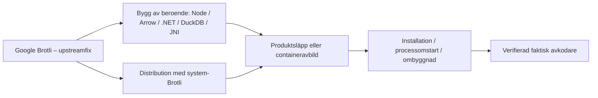

# Patchkedjan – från korrigerad källa till rättad driftsättning

**Källkontroll: 8 november 2026.** [Översikt](../README.md) · [Skydd](skydd.md)

**Samma grundfel, olika uppdateringsansvar:** Brotli-felet måste rättas där den använda kopian levereras – ibland i ett operativsystemspaket, ibland i en runtime, ibland genom en ny produktrelease eller container. Att en produkt behöver uppdateras betyder inte att dess utvecklare orsakat upstreamfelet. Samtidigt kan ingen lokal installation betraktas som rättad enbart för att grundbiblioteket har en publicerad fix.

## Daterad rättningsstatus och produktbesked

**Vad vet vi?** Tabellen återger daterade rättningar och leverantörsbesked för angivna versioner och distributionsformer, **inte** status för läsarens installation. **Vad vet vi inte?** Om rättningen verkligen körs lokalt, eller om en leverantör har publicerat nya besked efter **8 november 2026**. ”CVE-specifik rättning inte verifierad i öppet underlag” betyder **inte** ”rättning saknas”. **Vad bör göras ändå?** Följ leverantörens relevanta uppdateringsråd utan att invänta exploittest och verifiera den använda komponenten efter uppdatering.

| Komponent | Dokumenterad rättning eller leverantörsstatus (per 8 nov) | Villkor, nästa kontroll och källa |
| --- | --- | --- |
| **Google Brotli** | `1.0.10`, `1.1.1`, `1.2.1` per berörd gren | Grundfix; nås inte automatiskt av inbyggda kopior. [GitHub advisory](https://github.com/advisories/GHSA-9v8h-qqgm-4m35) |
| **Node.js uppströms** | `22.23.4`, `24.22.1`, `26.12.1` (första rättade i grenarna) | Gäller rättad Node-distribution; vissa Linuxpaket använder separat system-Brotli, och gamla EOL-grenar saknar uppströmsstöd. [Node.js](https://nodejs.org/en/blog/vulnerability/october-2026-security-releases) |
| **Microsoft .NET** | `8.0.33`, `9.0.22`, `10.0.14`; .NET 11-preview `RC3` | **Separat säkerhetsuppdatering 25 okt 2026**. Gäller de avkodningsvägar som Microsoft anger, **inte** varje `HttpClient`: ASP.NET Core request decompression och HTTP automatic response decompression är av som standard. Uppdatera rätt delad runtime och starta om; **self-contained/NativeAOT kräver ombyggnad och ny distribution**. **.NET Framework är inte berört av just denna advisory.** [Microsoft](https://github.com/dotnet/runtime/security/advisories/GHSA-p3jp-9v83-76w9) · [konkret kontroll](dataflode-till-patch.md#3-microsofts-net-rättning-vad-ska-uppdateras) |
| **PowerShell 7** | `7.4.22`, `7.5.13`, `7.6.9` (första rättade i grenarna enligt MSRC) | `Invoke-WebRequest` och `Invoke-RestMethod` i PowerShell 7 har automatisk Brotli-svarsavkodning på som standard. Uppdatera den **PowerShell-version som schemalagda skript faktiskt kör**. [MSRC](https://www.microsoft.com/en-us/msrc/blog/2026/10/patch-now-php2shell-brotli-emudhra-guidance-for-customers) · [dataflöde](dataflode-till-patch.md) |
| **Apache Arrow/PyArrow** | `26.0.1` uppdaterar medföljande Brotli i berörda PyArrow-wheels och R-binärer | Systemlänkade Arrow C++-byggen kan kräva separat system-Brotli. [Arrow](https://arrow.apache.org/blog/2026/11/03/26.0.1-release/) |
| **OSGeo4W Brotli** | `1.2.1-1` enligt distributionsunderlag 7 nov | Bekräftar tillgängligt paket, inte installerad DLL i alla QGIS-varianter. [OSGeo4W](https://download.osgeo.org/osgeo4w/v2/x86_64/setup.ini.bz2) |
| **Debian/Ubuntu** | Säkerhetsbackportar, versionsnummer skiljer sig | En äldre grundversion kan vara rättad. [Debian](https://security-tracker.debian.org/tracker/CVE-2026-111497) · [Ubuntu](https://ubuntu.com/security/CVE-2026-111497) |
| **Brotli4j** | `1.24.0`, inklusive relevanta `native-*` | Rättar medföljande native-kopia; systempaket hjälper inte ensamt. [Brotli4j](https://github.com/hyperxpro/Brotli4j/security/advisories/GHSA-x524-jrqf-vwq6) |
| **Python Brotli / brotlicffi** | PyPI `Brotli 1.2.1`, `brotlicffi 1.2.1.0` | Måste träffa den Pythonmiljö som programmet faktiskt använder. [GHSA](https://github.com/advisories/GHSA-9v8h-qqgm-4m35) |
| **3liz QGIS Server** | Avbild `4.2.3-1.9.7` enligt underhållaren 27 okt | Rättar dokumenterad `libbrotli1`-förekomst i den särskilda avbilden; andra images/versioner behöver eget underlag. [Issue #137](https://github.com/3liz/py-qgis-server/issues/137) |
| **ArcGIS Server** | Security 2026 Update 4 för 11.5, 12.0, 12.1 | Esris officiella produktpatch för den identifierade Node.js-frågan; välj rätt OS/produktversion. [Esri](https://support.esri.com/en-us/patches-updates/2026/arcgis-server-security-2026-update-4-patch) |
| **ArcGIS Pro 3.5+** | **Produktpatch ännu inte tillgänglig enligt Esris besked uppdaterat 7 nov** | Detta är ett daterat leverantörsbesked, **inte** aktuell garanterad patchstatus. .NET-rättning är separat; kontrollera Esris senare produktbesked. [Esri](https://www.esri.com/arcgis-blog/products/trust-arcgis/administration/brotli-vulnerabilities-broccoli2shell) |
| **FME Form/Flow** | **Leverantörsrapporterad påverkan**, men första CVE-rättade produktbyggnummer **inte verifierat i öppet underlag** 8 nov; system-Brotli kan rättas separat på Linux | Detta betyder **inte att FME saknar rättning**. Be Safe bekräfta rätt byggnummer, plattform och status för inbyggd DuckDB-kopia. [Safe](https://support.safe.com/hc/en-us/articles/50040725669517-Brotli-Decoder-CVE-2026-111497-Is-FME-Impacted) |
| **DuckDB** | Upstream-ändring för inbyggd Brotli dokumenterad | Ett merge/issue bevisar inte att rättningen nått viss DuckDB-release eller FME-utgåva. [DuckDB](https://github.com/duckdb/duckdb/issues/27660) |
| **GeoServer/GeoWebCache** | Ingen generell CVE-produktpatch fastställd | Kontrollera om någon faktiskt aktiv Brotli4j/Jetty/native-avkodare finns. [GeoServer-exempel](geoserver.md) |

**Kettle/Pentaho, Frends och Python:** en miljö med HTTP-klient ska **inte** få .NET-rättning per automatik. Följ **den faktiska körprocessen** och dess Java-/native-bibliotek, .NET-runtime eller Pythonhjul innan patch väljs. [Dataflöde till patch](dataflode-till-patch.md).

**Obs:** Safes offentliga release- och november-säkerhetsuppgifter innehåller flera byggnummer men den öppet kontrollerade dokumentationen kopplar dem inte till just CVE-2026-111497. Skriv inte att de är Brotli-rättade utan separat belägg. [Safes öppna novemberartikel](https://support.safe.com/hc/en-us/articles/46792031942029-FME-November-2026-Security-Updates) · [FME Download](https://fme.safe.com/downloads/).

**Datum gäller de angivna beskeden, inte framtida versioner:** Esris besked uppdaterades **7 november 2026**, avlästes **8 november**, och Security 2026 Update 4 gäller angivna ArcGIS Server-versioner. Microsofts CVE-specifika .NET-besked publicerades **25 oktober 2026**, avläst **8 november**. Safe-artikeln lästes **7 november** men krävde konto vid anonym kontroll **8 november**; rättade FME-byggnummer är därför **inte verifierade här**. Kontrollera den aktuella leverantörssidan innan ett senare patchbeslut.

**Vänta inte på produktspecifik reproduktion** innan en relevant, leverantörsrekommenderad säkerhetsuppdatering installeras. Patchtillgänglighet och bekräftad exponering är separata uppgifter.

## Varför kan en patch missa målet?

- **Rätt upstream, gammalt beroende:** Google har rättat Brotli, men ett nedströmsprojekt har ännu inte byggt om sitt bibliotek eller publicerat en ny produkt.
- **Rätt systembibliotek, gammal inbyggd kopia:** systemet uppdateras men Arrow-wheel, DuckDB, Node, .NET eller native-JAR innehåller en separat avkodare.
- **Rättat paket, gammal process:** tjänsten startades inte om och kan fortsätta använda redan laddad kod.
- **Rättat image-base, gammal container:** en engångsbyggd image eller gammal digest används trots att ny bas finns i registret.
- **Fel miljö:** system-Python uppdateras, men QGIS eller ArcGIS använder egen Python/conda-runtime; PATH pekar mot en annan Node-exekverbar fil än den som kör servern.

## Tre separata statusar

1. **Upstream-fix finns:** grundkomponenten har rättats; det säger inget ensamt om den färdiga produkten.
2. **Produkt-/distributionsrättning finns:** leverantören har publicerat en rättning för angiven version och plattform. Där rättningen inte kunnat verifieras i öppet underlag, skriv **”CVE-specifik rättning inte verifierad här”**, inte ”ingen rättning finns”.
3. **Installationen är verifierat rättad:** den faktiskt körande avkodaren använder rättad kod efter driftsättning/omstart; detta kräver lokal kontroll.

Ingen allmän repo-text kan bekräfta punkt 3 för alla läsare. Om patch saknas behöver den ansvariga välja tillfällig riskbegränsning utifrån *den faktiska attackvägen*, inte bara en nätverksbrandvägg. [Skydd](skydd.md).
