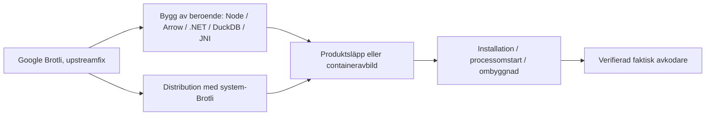

# Patchkedjan: från rättat bibliotek till uppdaterad installation

**Källkontroll: 8 till 10 november 2026.** [Översikt](../README.md) · [Skydd](skydd.md)

Brotli behöver rättas där den använda kopian levereras: i operativsystemets paket, i en runtime, i en produktrelease eller i en container. Att en produkt behöver uppdateras betyder inte att dess utvecklare orsakat upstreamfelet. Samtidigt kan ingen lokal installation betraktas som rättad enbart för att grundbiblioteket har en publicerad fix.

## Distributionsskillnader: Red Hat som exempel

I [Red Hats CVE-besked](https://access.redhat.com/security/cve/cve-2026-111497) skiljs mellan system-Brotli och kopior som följer med runtimepaket. Exempelvis använder **Node.js 24 i RHEL 8/9** en medföljande Brotli-kopia, medan **Node.js 22 i samma RHEL-grenar** använder systemets Brotli; paketförhållandena kan vara annorlunda i RHEL 10. En rättning av systempaketet behöver därför inte rätta den medföljande kopian. Följ den aktuella distributionens egen CVE-status och eventuella säkerhetsbackportar i stället för att tillämpa en generell Node- eller Brotli-versionsregel. Detta är distributionsspecifika fakta, inte ett besked om en viss driftsatt GIS-tjänst.

## Daterad rättningsstatus och produktbesked

Tabellen sammanfattar rättningar och leverantörsbesked som kontrollerats senast **9 november 2026**, med särskilda datum där uppgifterna är äldre. Den visar inte vilken rättning som körs lokalt. Om ett CVE-specifikt rättat produktbygge inte kunnat verifieras i öppna källor kan det ändå finnas. Följ leverantörens råd och kontrollera den använda komponenten efter uppdatering.

| Komponent | Dokumenterad rättning eller leverantörsstatus (kontrollerad senast 9 nov) | Villkor, nästa kontroll och källa |
| --- | --- | --- |
| **Google Brotli** | `1.0.10`, `1.1.1`, `1.2.1` per berörd gren | Grundfix; nås inte automatiskt av inbyggda kopior. [GitHub advisory](https://github.com/advisories/GHSA-9v8h-qqgm-4m35) |
| **Node.js uppströms** | `22.23.4`, `24.22.1`, `26.12.1` (första rättade i grenarna) | Gäller rättad Node-distribution; vissa Linuxpaket använder separat system-Brotli, och gamla EOL-grenar saknar uppströmsstöd. [Node.js](https://nodejs.org/en/blog/vulnerability/october-2026-security-releases) |
| **Microsoft .NET** | `8.0.33`, `9.0.22`, `10.0.14`; .NET 11-preview `RC3` | **Separat säkerhetsuppdatering 25 okt 2026**. Gäller de avkodningsvägar som Microsoft anger, **inte** varje `HttpClient`: ASP.NET Core request decompression och HTTP automatic response decompression är av som standard. Uppdatera rätt delad runtime och starta om; **self-contained/NativeAOT kräver ombyggnad och ny distribution**. **.NET Framework är inte berört av just denna advisory.** [Microsoft](https://github.com/dotnet/runtime/security/advisories/GHSA-p3jp-9v83-76w9) · [konkret kontroll](dataflode-till-patch.md#3-microsofts-net-rättning-vad-ska-uppdateras) |
| **PowerShell 7** | `7.4.22`, `7.5.13`, `7.6.9` (första rättade i grenarna enligt MSRC) | `Invoke-WebRequest` och `Invoke-RestMethod` i PowerShell 7 har automatisk Brotli-svarsavkodning på som standard. Uppdatera den **PowerShell-version som schemalagda skript faktiskt kör**. [MSRC](https://www.microsoft.com/en-us/msrc/blog/2026/10/patch-now-php2shell-brotli-emudhra-guidance-for-customers) · [dataflöde](dataflode-till-patch.md) |
| **Apache Arrow/PyArrow** | `26.0.1` uppdaterar medföljande Brotli i berörda PyArrow-wheels och R-binärer | Systemlänkade Arrow C++-byggen kan kräva separat system-Brotli. [Arrow](https://arrow.apache.org/blog/2026/11/03/26.0.1-release/) |
| **OSGeo4W Brotli** | `1.2.1-1` i paketarkivet per 10 nov | Rättat huvudpaket, inte bevis för alla DLL-kopior. [OSGeo4W Brotli](https://www.norbit.de/osgeo4w/v2/x86_64/release/brotli/) |
| **QGIS fristående Windows-MSI** | `3.44.15-2` och `4.2.3-2`, arkiverade 6 okt; Brotli 1.2.0 enligt installationskontroller | Ingen ny rättad fristående MSI verifierad 10 nov. Medföljande OSGeo4W Setup kan uppdatera paket i dess rot, men resultatet måste verifieras. [QGIS arkiv](https://qgis.org/downloads-list/) · [Setup-besked](https://trac.osgeo.org/osgeo4w/ticket/893#comment:2) |
| **GRASS i OSGeo4W** | Stabil `grass 8.5.0-1` från 12 juni; separat äldre Brotli-kopia observerad efter uppdatering av huvudpaketet | Varken `grass-dev` eller en ombyggd stabil version är verifierad som rättad. [GRASS arkiv](https://www.norbit.de/osgeo4w/v2/x86_64/release/grass/) · [GRASS byggskript](https://github.com/OSGeo/grass/blob/main/mswindows/osgeo4w/package.sh) |
| **Debian/Ubuntu** | Säkerhetsbackportar, versionsnummer skiljer sig | En äldre grundversion kan vara rättad. [Debian](https://security-tracker.debian.org/tracker/CVE-2026-111497) · [Ubuntu](https://ubuntu.com/security/CVE-2026-111497) |
| **Brotli4j** | `1.24.0`, inklusive relevanta `native-*` | Rättar medföljande native-kopia; systempaket hjälper inte ensamt. [Brotli4j](https://github.com/hyperxpro/Brotli4j/security/advisories/GHSA-x524-jrqf-vwq6) |
| **Python Brotli / brotlicffi** | PyPI `Brotli 1.2.1`, `brotlicffi 1.2.1.0` | Måste träffa den Pythonmiljö som programmet faktiskt använder. [GHSA](https://github.com/advisories/GHSA-9v8h-qqgm-4m35) |
| **3liz QGIS Server** | Avbild `4.2.3-1.9.7` enligt underhållaren 27 okt | Rättar dokumenterad `libbrotli1`-förekomst i den särskilda avbilden; andra images/versioner behöver eget underlag. [Issue #137](https://github.com/3liz/py-qgis-server/issues/137) |
| **ArcGIS Server** | Security 2026 Update 4 för 11.5, 12.0, 12.1 | Esris officiella produktpatch för den identifierade Node.js-frågan; välj rätt OS/produktversion. [Esri](https://support.esri.com/en-us/patches-updates/2026/arcgis-server-security-2026-update-4-patch) |
| **ArcGIS Mission Server** | Security 2026 Update 1 för 11.5, 12.0, 12.1 (9 nov 2026) | Separat Esri-patch för Windows/Linux, `BUG-000188431`. [Esri](https://support.esri.com/en-us/patches-updates/2026/arcgis-mission-server-security-2026-update-1-patch) |
| **ArcGIS Pro 3.5+** | **Produktpatch ännu inte tillgänglig enligt Esris besked uppdaterat 7 nov** | Detta är ett daterat leverantörsbesked, **inte** aktuell garanterad patchstatus. .NET-rättning är separat; kontrollera Esris senare produktbesked. [Esri](https://www.esri.com/arcgis-blog/products/trust-arcgis/administration/brotli-vulnerabilities-broccoli2shell) |
| **FME Form/Flow** | Safe bekräftar påverkan i 2024.2 till 2026.3. I artikeln, kontrollerad 9 november via inloggad webbläsare, anges rättade byggen för 2026.1 till 2026.3 som under arbete. CVE-rättat byggnummer inte bekräftat. | Windows/macOS: medföljande Brotli. Linux: system-Brotli för HTTP och Parquet, men DuckDB har egen kopia. Följ Safes [CVE-besked](https://support.safe.com/hc/en-us/articles/50040725669517-Brotli-Decoder-CVE-2026-111497-Is-FME-Impacted) för både FME och DuckDB. |
| **DuckDB** | Upstream-ändring för inbyggd Brotli dokumenterad | Ett merge/issue bevisar inte att rättningen nått viss DuckDB-release eller FME-utgåva. [DuckDB](https://github.com/duckdb/duckdb/issues/27660) |
| **GeoServer/GeoWebCache, inklusive GDAL-tillägg** | Ingen generell CVE-produktpatch fastställd | Undersök aktiva Brotli4j/Jetty-tillägg **och eventuell ImageI/O-Ext GDAL/JNI-stapel i Tomcat**. `CURL_ENABLED=YES` visar cURL-stöd i GDAL, inte Brotli-användning eller CVE-exploatering. [GeoServer](geoserver.md) · [GeoServers GDAL-dokumentation](https://docs.geoserver.org/stable/en/user/data/raster/gdal/) |

**Kettle/Pentaho, Frends och Python:** en miljö med HTTP-klient ska **inte** få .NET-rättning per automatik. Följ **den faktiska körprocessen** och dess Java-/native-bibliotek, .NET-runtime eller Pythonhjul innan patch väljs. [Dataflöde till patch](dataflode-till-patch.md).

Safes offentliga release- och säkerhetsuppgifter från november innehåller flera byggnummer. Varken Safes öppna novemberartikel eller det CVE-specifika besked som lästes 9 november knyter dessa byggnummer till en färdig Brotli-rättning. Skriv inte att de är Brotli-rättade utan separat belägg. [Safes öppna novemberartikel](https://support.safe.com/hc/en-us/articles/46792031942029-FME-November-2026-Security-Updates) · [FME Download](https://fme.safe.com/downloads/).

**Källornas datum:** Esris artikel uppdaterades **7 november 2026** och kontrollerades igen **9 november**. Server-patchen publicerades 5 november. Microsofts .NET-besked publicerades **25 oktober**. Safes CVE-specifika artikel kontrollerades igen 9 november via inloggad läsning. Den anger ännu rättade FME-byggen som under arbete och en separat DuckDB-rättning. Safes öppna novemberartikel gäller andra säkerhetsbrister.

Installera leverantörens rekommenderade säkerhetsuppdatering utan att först försöka reproducera sårbarheten i produkten. Patchtillgänglighet och bekräftad exponering är separata uppgifter.

## Kontrollera rättad process, inte bara rättat paket

På Linux kan en distributionsuppdatering installera korrigerad `libbrotlidec` samtidigt som en **redan körande tjänst** fortfarande använder en tidigare laddad bibliotekskopia. En ansvarig administratör kan i en auktoriserad miljö kontrollera den aktuella processens laddade biblioteksfiler, exempelvis genom processkartläggning i `/proc/<PID>/maps` när åtkomst medges, och jämföra med distributionspaket, leverantörsbesked och eventuella backportar. En versionssträng på disk eller ett CVE-omnämnande i en paketlogg styrker inte ensamt vilken kod processen använder. En process som laddar biblioteket statiskt eller från en container kan kräva en annan inventeringsmetod.

Efter relevant uppdatering kan **omstart eller omdriftsättning** krävas. Kontrollera vilken process, containeravbild/digest och eventuella inbyggda kopior som verkligen används. Genomför inte automatiska omstarter eller installationer i produktion utan ordinarie driftbeslut. [Metod och bevisnivåer](metod.md).

## Varför kan en patch missa målet?

- **Rätt upstream, gammalt beroende:** Google har rättat Brotli, men ett nedströmsprojekt har ännu inte byggt om sitt bibliotek eller publicerat en ny produkt.
- **Rätt systembibliotek, gammal inbyggd kopia:** systemet uppdateras men Arrow-wheel, DuckDB, Node, .NET eller native-JAR innehåller en separat avkodare.
- **Rättat paket, gammal process:** tjänsten startades inte om och kan fortsätta använda redan laddad kod.
- **Rättad basavbild, gammal container:** den driftsatta avbilden har fortfarande ett gammalt innehåll eller en äldre digest.
- **Fel miljö:** system-Python uppdateras, men QGIS eller ArcGIS använder egen Python/conda-runtime; PATH pekar mot en annan Node-exekverbar fil än den som kör servern.

När GeoServer använder Java, Tomcat/Jetty, tillägg och separat native GDAL behöver samtliga delar ingå i uppgraderingskontrollen. Verifiera stöd för **hela kombinationen** före driftbyte och kontrollera varje relevant inläst bibliotek efteråt. Exempelvis kan ECW-lager behöva ett fungerande GDAL-/JNI-/codec-paket även när inga Brotli-data används. Modulsträngar som `SNAPSHOT` behöver granskas mot **byggursprung och releasekompatibilitet**; GeoServer- och GeoTools-versioner tillhör dessutom olika versionsserier. [GeoServer: uppgradering och native beroenden](geoserver.md).

## Tre separata statusar

1. **Upstream-fix finns:** grundkomponenten har rättats; det säger inget ensamt om den färdiga produkten.
2. **Produkt-/distributionsrättning finns:** leverantören har publicerat en rättning för angiven version och plattform. Där rättningen inte kunnat verifieras i öppet underlag, skriv **”CVE-specifik rättning inte verifierad här”**, inte ”ingen rättning finns”.
3. **Installationen är verifierat rättad:** den faktiskt körande avkodaren använder rättad kod efter driftsättning/omstart; detta kräver lokal kontroll.

Ingen allmän repo-text kan bekräfta punkt 3 för alla läsare. Om patch saknas behöver den ansvariga välja tillfällig riskbegränsning utifrån *den faktiska attackvägen*, inte bara en nätverksbrandvägg. [Skydd](skydd.md).
