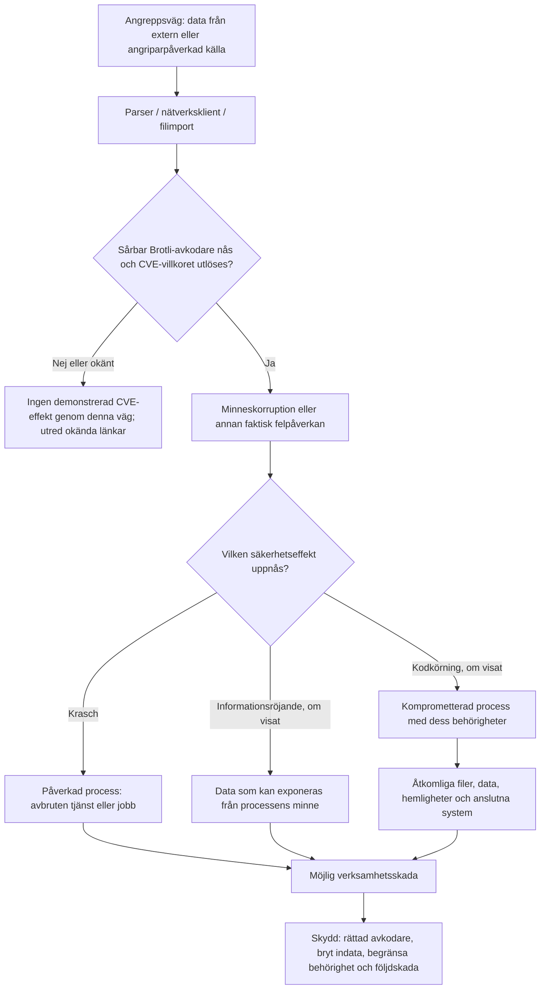

# Riskkedjan: från angriparpåverkad indata till verksamhetsskada och skydd

**CVE-2026-111497 · Underlag kontrollerat 8 november 2026.** [CVE-felet](cve-mekanism.md) · [Supply chain](supply-chain.md) · [Skydd](skydd.md) · [Rättningar](patchkedjan.md)

**Vill du börja utan teknisk förkunskap eller identifiera vem som ska åtgärda?** [Börja här](borja-har.md).

**Syftet:** kunna bedöma ett system även när dess produktnamn saknas i varje CVE-lista. Börja med vad som *kan* komma in, följ den faktiska avkodaren, identifiera **vilken process** som kan påverkas och undersök därefter vad den processen har möjlighet att skada eller komma åt. Först då går det att välja rätt skydd och bedöma uppdateringsbehov.

**Viktig begränsning:** kedjan är **villkorad**, inte en automatisk följd. Att avkodaren får en felaktig ström betyder inte att CVE:n utlöses. Att en out-of-bounds-skrivning uppstår betyder inte att någon har tagit kontroll över processen. Krasch, informationsröjande och fjärrkodkörning är **olika möjliga resultat** med separata beviskrav. RCE har demonstrerats i avgränsade Node.js-testbyggen, **inte generellt för GIS-program**. [Node.js](https://nodejs.org/en/blog/vulnerability/october-2026-security-releases) · [Imperva](https://www.imperva.com/blog/node2shell-from-brotli-data-to-remote-code-execution/).

## Läs riskkedjans fem led

| Led | Vad måste utredas i den egna miljön? | Vad hjälper och var hjälper det? |
| --- | --- | --- |
| **1. Angreppsväg** | Vem kan påverka en HTTP-begäran, ett hämtat svar, en fil, en import eller en automatiserad dataleverans? Vilken förtroendegräns passeras? | Stoppa eller begränsa onödig avkodning, validera källa/filflöde, använd TLS mot nätverks-MITM, kontrollera extern hämtning. Dessa åtgärder bryter **vissa ingångar**, inte alla. |
| **2. Påverkad eller komprometterad process** | Vilket program och vilken faktiskt laddad Brotli-kopia avkodar? Vilka felvillkor är belagda? Vid vilken effekt kraschar processen, och när är kodkörning endast hypotetisk? | **Patcha rätt bibliotekskopia, runtime eller produkt** och verifiera körande version. Isolera osäkra parserjobb. |
| **3. Åtkomliga resurser** | Vad kan just den processen läsa eller ändra? Körkonto, databaser, integrationer, delade mappar, nätverksvägar, processminne, loggar, miljövariabler, tokens och hemligheter? | Minsta privilegium, begränsade och separata tjänstekonton, nätverkssegmentering, isolering av arbetsytor, restriktiv åtkomst till hemligheter. |
| **4. Möjlig skada** | Kan avbrott stoppa ett viktigt flöde? Kan faktiskt informationsröjande exponera personuppgifter? Skulle framgångsrik kodkörning kunna möjliggöra ändringar, datastöld eller vidare intrång? | Övervakning, kontinuitetsplanering, verifierad återläsning/backup, loggning, separata administrativa rättigheter och ordinarie incidentprocess. |
| **5. Nödvändiga skydd** | Är patchen tillgänglig, installerad och aktiv? Vilken extra spärr bryter **just den här** ingången, och vilken kontroll reducerar skadan om en tidigare spärr fallerar? | Prioritera rättad avkodare; dokumentera kompenserande kontroller, verifierad effekt och kvarvarande osäkerhet. [Skydd](skydd.md) · [Patchkedja](patchkedjan.md). |

**Två olika försvarsmål:** (a) hindra att felaktiga data når en berörd avkodare och (b) begränsa följderna *om processen ändå påverkas*. En brandvägg, filskanning eller antivirus kan inte ersätta en rättad avkodare. En patch kan inte ensam avgöra vilka affärskritiska resurser processen redan har åtkomst till. [OWASP Threat Modeling](https://cheatsheetseries.owasp.org/cheatsheets/Threat_Modeling_Cheat_Sheet.html) · [OWASP File Upload](https://cheatsheetseries.owasp.org/cheatsheets/File_Upload_Cheat_Sheet.html).

## Slutbedömning efter inventering

**Avsluta varje undersökt angreppsväg med samma sex uppgifter.** Skriv **”okänt, undersök”** där underlag saknas. **Påverkan** avser vad som är belagt om den aktuella avkodaren/produkten; **exponering** avser om angriparpåverkad data kan nå den i drift. Håll **sårbar kod**, **nåbar kodväg**, **faktisk CVE-utlösning** och **visad säkerhetseffekt** åtskilda. *Prioritet* gäller nästa **åtgärd eller kontroll**, inte en påhittad numerisk risksiffra.

| Fält | Fråga för just den här installationen |
| --- | --- |
| **Påverkan** | Finns dokumenterat berörd avkodare i denna produkt/version, eller är det bara en möjlig beroendeväg? |
| **Exponering** | Körs processen och kan någon styra det Brotli-innehåll som faktiskt avkodas? Krävs autentisering, ett klick eller en schemalagd hämtning? |
| **Konsekvens** | Krasch och avbrutet jobb; separat eventuellt visat röjande/kodkörning och vilka resurser processen når. |
| **Prioritet** | Rätta skyndsamt, inventera snarast, hantera i ordinarie uppdatering eller verifiera redan införd rättning, med skäl. |
| **Rättning** | Exakt komponent och distributionsnivå; *tillgänglig*, *installerad* och *verifierad i körande process* är tre olika lägen. |
| **Kvarvarande osäkerhet** | Vad måste undersökas innan man kan påstå låg risk, ej påverkad eller färdigpatchad? |

**Viktigt:** En bekräftat berörd produkt med en **okänd indataväg** ska inte automatiskt klassas som exploaterbar. En obekräftad produkt med en automatiserad hämtning ska inte automatiskt klassas som säker. En hypotetisk RCE är inte ett påvisat personuppgiftsläckage. [Prioriteringsprinciper](skydd.md#prioritera-aktiva-riskkedjor) · [Tekniska bevisnivåer](metod.md).

## Exempel: FME-integration som behandlar personuppgifter

*Hypotetiskt verksamhetsexempel, inte en kartläggning av någon verklig Lifecare-installation eller konstaterad personuppgiftsincident.* Anta att en organisation använder **FME** för att överföra uppgifter till eller från ett verksamhetssystem, exempelvis Lifecare.

| Kedjelänk | Exempel, vad förvaltaren ska kontrollera |
| --- | --- |
| **Angreppsväg** | Finns HTTPCaller/OpenAPICaller, webbanslutningar eller schemalagd hämtning som kan ta emot Brotli-kodat svar? Importeras Parquet eller används DuckDB? Kan innehåll påverkas av en extern leverantör, en delad mapp eller ett komprometterat konto? |
| **Påverkad process** | Vilken **FME Engine/Workbench-process** avkodar materialet, med vilken Brotli-kopia och version? Finns en leverantörsbekräftad påverkan för den aktuella distributionsformen? Har någon faktisk effekt på just detta bygge demonstrerats? |
| **Åtkomliga resurser** | Under vilket konto kör just jobbet? Kan processen nå verksamhetssystemet, dess personuppgifter, anslutningshemligheter, databaser, delade mappar eller filer från andra flöden? Är arbetsytor/konton isolerade? **Anta inte att en arbetsytas åtkomst automatiskt gäller alla andra.** |
| **Möjlig skada** | En **krasch** kan fördröja eller stoppa överföringar och påverka tillgänglighet. **Informationsröjande** skulle behöva en påvisad läckväg och känsligt minnesinnehåll. **Lyckad kodkörning** skulle kunna påverka den data och de anslutningar som processen verkligen har rätt till. Att personuppgifter finns i ett anslutet system är *inte* bevis för läckage. |
| **Nödvändiga skydd** | Kontrollera rättad FME-/system-/DuckDB-avkodare, begränsa angriparpåverkade indata, ge integrationen minsta behörighet, skydda och avgränsa credentials, följ jobbfel och planera återställning. Utred eventuella faktiska incidenttecken separat från en teoretisk sårbarhet. |

**Den praktiska frågan är alltså inte bara ”använder vi DuckDB?” utan:** Vilka *arbetsytor och anslutningar* kan skicka angriparpåverkad data till FME? Vilka *FME-processer och körkonton* kör dem? Vilka *personuppgifter och rättigheter* kan finnas inom just deras räckvidd? [FME:s avkodningsvägar](fme.md) · [leverantörens säkerhetsbesked](https://support.safe.com/hc/en-us/articles/50040725669517-Brotli-Decoder-CVE-2026-111497-Is-FME-Impacted) (kan kräva inloggning).

En riskkedja kan alltså vara **viktig att åtgärda utan att ett intrång har skett**. Misstänkt eller bekräftad påverkan på personuppgifter ska däremot hanteras enligt organisationens incidentrutiner; att ett sårbart beroende identifierats är inte i sig belägg för en personuppgiftsincident.

**Slutbedömning av denna riskkedja (exempel, ingen verifierad lokal installation):**

| Fält | Bedömning |
| --- | --- |
| **Påverkan** | Safe rapporterar relevanta FME-avkodningsvägar; exakt kopia i det hypotetiska jobbet är inte fastställd. |
| **Exponering** | Okänd, kontrollera om arbetsytan/Engine verkligen avkodar angriparpåverkade HTTP-svar eller filer. |
| **Konsekvens** | Krasch kan stoppa överföring. Personuppgiftsåtkomst är en möjlig följd **endast** vid relevant säkerhetseffekt och faktiska behörigheter; inget läckage belagt. |
| **Prioritet** | **Inventera snarast** om jobbet körs automatiskt mot extern källa och har känsliga behörigheter; **rätta skyndsamt om en nåbar berörd avkodare bekräftas**. |
| **Rättning** | FME-/system-/DuckDB-kopian beroende på använd väg; kontrollera CVE-specifik Safe-status och körande version. |
| **Kvarvarande osäkerhet** | Verklig arbetsyta, decoder, Engine-konto, isolering, åtkomliga anslutningar och CVE-specifik produktpatch. |

## Exempel: öppna data från API och separat känslig integration

Ett **hypotetiskt** FME Flow hämtar öppna geodata från en dokumenterad Swagger/OpenAPI-endpoint med `HTTPCaller`, medan samma FME-miljö även har en personuppgiftsintegration, exempelvis ett omsorgssystem. Att API:et tillhör en känd myndighet gör inte dess svar till en säker komprimerad dataström. Det betyder däremot **inte** att öppna data eller FME generellt är ett angrepp, och inte att ett personuppgiftssystem har exponerats.

| Riskled | Vad ska kontrolleras? |
| --- | --- |
| **Angreppsväg** | Hämtar jobbet ett `Content-Encoding: br`-svar? Kan någon påverka de komprimerade svaren? Skilj legitim leverantör, komprometterad datakälla och HTTP-MITM. [Swagger/API-förklaring](http-angreppsvagar.md#öppna-data-via-swaggeropenapi-ett-api-svar-inte-ett-eget-filformat). |
| **Påverkad process** | Vilken FME Engine utför anropet, vilken Brotli-implementation används, är den rättad och vad är faktiskt belagt om CVE-trigger i den miljön? |
| **Åtkomliga resurser** | Har **just denna process** åtkomst till känsliga anslutningar, hemligheter, nätverk eller data? Kör integrationerna isolerat eller under olika konton? Samma FME-installation är inte automatiskt samma behörighet eller process. |
| **Möjlig skada** | Krasch: avbrutet eller försenat jobb. Minnesröjande: kräver faktiskt påvisad väg. Eventuell RCE: kan ge vidare åtkomst **bara inom processens och miljöns verkliga rättigheter**. Ingen personuppgiftsläcka följer automatiskt av ett sårbart bibliotek. |
| **Nödvändiga skydd** | Patcha faktiskt använd Brotli-kopia, avgränsa jobb och tjänstekonton, begränsa nätverk och autentiseringsuppgifter, använd verifierad HTTPS, logga avbrott och följ incidentrutiner vid faktiska tecken på påverkan. |

Samma härledning gäller en nedladdning i webbläsare eller Python: **byt ut process och åtkomliga resurser**, inte CVE-felet. [Allmän metod för andra program](ny-programvara.md) · [praktisk kontroll av X-data via Y i FME, Frends, ArcGIS, Python och Kettle](dataflode-till-patch.md).

**Fler konkreta riskkedjor:** [Frends-integrationer, ArcGIS STAC, Origo/GeoServer/MSSQL, Gaida/FB och EntryScape](verksamhetsfloden.md). Kartlägg vilka rättigheter just den berörda processen faktiskt har; ett annat jobb på samma server innebär inte automatiskt samma behörighet eller minne.

**Slutbedömning av denna riskkedja (exempel, ingen verifierad lokal installation):**

| Fält | Bedömning |
| --- | --- |
| **Påverkan** | Safe rapporterar FME-HTTP-väg; ingen påverkan på en bestämd myndighets-API-hämtning är visad. |
| **Exponering** | Om ett attackerbart `Content-Encoding: br`-svar når en berörd decoder; Swagger/HTTPS räcker inte som belägg. |
| **Konsekvens** | Möjligt jobbavbrott; åtkomst till andra integrationer endast om **samma berörda process/miljö** har relevanta rättigheter och vidare exploatering sker. |
| **Prioritet** | **Kontrollera HTTP-avkodning och behörighetsseparation först**; vid verifierad aktiv sårbar väg, prioritera rättning efter åtkomliga resurser. |
| **Rättning** | Den FME- eller OS-bibliotekskopia som faktiskt avkodar svaret; separat filimport kan kräva annan patch. |
| **Kvarvarande osäkerhet** | Faktiskt svarshuvud, decoder, processisolering och CVE-specifik patchstatus. |

## Ytterligare tre jämförelser

| Situation | Process och relevanta resurser | Rimlig skada och avgörande skydd |
| --- | --- | --- |
| **Publik Node/Express-tjänst med inkommande `br`-avkodning** | Serverprocess med tjänstekonto; eventuella interna API:er, hemligheter, loggar och skrivbehörighet. | Externt avkodningsangrepp kan bli möjligt där parsern är nåbar. Rättad Node-runtime, `br`-spärr **före** avkodning vid behov och begränsade rättigheter. Att porten är publik eller Node gammal räcker **inte ensamt** för att visa denna väg. [Express](https://expressjs.com/en/blog/2026-10-31-security-releases/). |
| **QGIS eller annat skrivbordsprogram öppnar ett dataset** | Process under användarkontot; åtkomst till projektfiler, användarens nätverksresurser och eventuellt lagrade anslutningar. | Kräver relevant fil-/HTTP-indata och att berörd avkodare faktiskt används. Rättad distribution, kontrollerade importer, begränsad användarbehörighet. Att inga okända filer öppnas kan minska just filvägen men utesluter inte andra flöden. [QGIS](qgis.md). |
| **AutoCAD, myCarta eller annat program utan fastställd produktpåverkan** | Okänd kod- och processkedja; ingen resurs eller effekt ska antas utan lokal inventering. | Kartlägg filimport, HTTP, tillägg och eventuella inbyggda/systemlänkade avkodare. Först därefter väljs relevant patch och riskbegränsning. **Inga produktspecifika CVE-påståenden görs här.** [Ny programvara](ny-programvara.md). |

## Skriv en riskkedja för ett eget system

Detta kort kan fyllas i **utan att använda CVE-utlösande data eller aktiv testning mot en tjänst**:

> - **Miljö och version:** applikation, instans, arbetsyta, körkonto, operativsystem/container och datum.
> - **Angreppsväg:** källa, fil/API/HTTP-ingång, angriparens möjliga kontroll och förtroendegräns.
> - **Avkodningskedja:** parser → beroenden → exakt Brotli-kopia; vad är bevisat och vad är okänt?
> - **Påverkad process:** normal driftfunktion, aktiva rättigheter, vilket resultat av CVE som faktiskt är visat.
> - **Åtkomliga resurser:** verklig åtkomst till personuppgifter, filer, system, hemligheter, databaser och nätverk, pröva isolering.
> - **Möjlig skada:** separat för krasch/tillgänglighet, belagt röjande och eventuell kodkörning/vidare intrång.
> - **Nödvändiga skydd:** CVE-rättning, kontroller som bryter indatavägen, minsta privilegium, övervakning och återställning.
> - **Status:** underlag, osäkerheter, faktisk patchstatus i drift och kvarvarande risk.

**Publicering:** dokumentera generella metoder öppet, men lägg inte ut en verklig organisations personuppgiftsflöden, interna åtkomster, tjänstekonton eller svagheter i en publik riskkedja. Behåll sådana uppgifter i organisationens interna säkerhetsarbete. [Bevis- och publiceringsgränser](metod.md).
