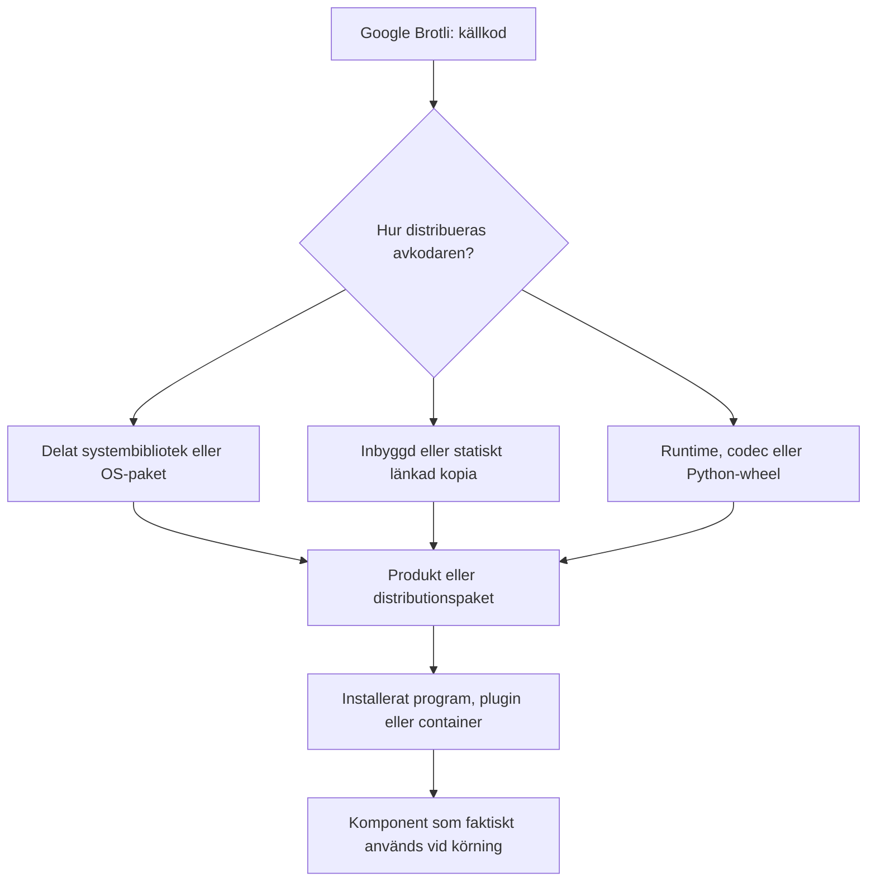

# Supply chain: hur sårbar Brotli-kod når ett GIS-program

**Källunderlag kontrollerat 8 november 2026.** [Översikt](../README.md) · [Metod och bevisgränser](metod.md) · [Riskkedja](riskkedja.md) · [Patchkedja](patchkedjan.md).

Den här sidan förklarar hur **CVE-2026-111497** kan följa med genom legitima programvaruberoenden. Det handlar om **spridning av ett sårbart bibliotek i programvara**, inte om att ett angrepp mot själva programvaruleveranskedjan har påvisats. Exemplen är inte en uttömmande lista över påverkade produkter.

**Vad vet vi?** Felet finns i Googles Brotli-avkodare. Specifik felaktig komprimerad indata kan orsaka en *out-of-bounds write* (skrivning utanför en avsedd minnesbuffert). Berörd kod kan distribueras som systembibliotek, inbyggd kopia eller del av ett annat beroende. [CVE-posten](https://www.cve.org/CVERecord?id=CVE-2026-111497).

**Vad vet vi inte?** Ett beroendefynd bevisar inte att en viss produkt använder den berörda avkodaren för angriparpåverkade data, att CVE:ns felvillkor går att utlösa där eller att någon särskild säkerhetseffekt har demonstrerats. Frånvaro av ett hittat beroende är inte heller en generell säkerhetsgaranti.

**Vad bör göras ändå?** Följ säkerhetsuppdateringar som gäller den aktuella produkten och versionen, utan att invänta egen CVE-reproduktion. Kontrollera vilken kodkopia produkten faktiskt använder och om rättningen har nått installationen. [Rättningsstatus per 8 november](patchkedjan.md).

## 1. Hur hamnar Brotli i ett program?



Kedjan visar **hur en viss kodkopia kan nå produkten**, inte om den kan angripas. Två installationer av samma program kan använda olika bibliotek och därför kräva olika rättningar. Ett uppdaterat system-Brotli rättar till exempel inte automatiskt en inbyggd kopia. [OWASP om beroendegrafer och SBOM](https://cheatsheetseries.owasp.org/cheatsheets/Dependency_Graph_SBOM_Cheat_Sheet.html).

En separat **indata- eller angreppsväg** behövs för att bedöma om någon kan påverka data som når avkodaren. Det kan gälla HTTP-svar, inkommande begäranden eller Brotli-komprimerade delar i filer, men varje sådan väg måste beläggas för den aktuella produkten. [HTTP-vägar](http-angreppsvagar.md) · [Filvägar](fil-angreppsvagar.md) · [Riskkedja och möjliga konsekvenser](riskkedja.md).

## 2. Vad kan ett beroendefynd faktiskt visa?

| Underlag | Vad det kan besvara | Vad det inte ensamt bevisar |
| --- | --- | --- |
| **SBOM** (Software Bill of Materials) | Vilka komponenter som uppges ingå i en viss produkt eller byggning. | Att listan är fullständig, att koden körs eller att produkten kan exploateras. |
| **Beroendegraf och bygginformation** | Hur ett bibliotek kommer in i produkten, direkt eller via andra komponenter. | Att angriparpåverkad data når just den sårbara funktionen. |
| **VEX** (Vulnerability Exploitability eXchange) | Hur en leverantör eller annan utfärdare bedömer påverkan av en viss CVE för definierad produkt och version, med angivna skäl. | Att bedömningen automatiskt gäller andra versioner, installationer eller tillägg. |
| **Kontroll av installerad och körande komponent** | Vilken Brotli-kopia som faktiskt laddas och om den är rättad. | Att all annan möjlig avkodning i produkten också är granskad. |

**Sårbar komponent ≠ nåbar avkodare ≠ CVE-specifik utlösning ≠ demonstrerad säkerhetseffekt.** En VEX-status som ”inte påverkad” bör bara återges för den omfattning och med de belägg som utfärdaren anger. Om påverkan inte kan avgöras är den **okänd**, inte automatiskt låg eller hög. [CISA:s minimikrav för VEX](https://www.cisa.gov/sites/default/files/2023-04/minimum-requirements-for-vex-508c.pdf) · [bevisnivåer](metod.md).

## 3. Exempel: Brotli via Arrow och GDAL till QGIS

En dokumenterad beroende- och avkodningsväg i **vissa QGIS-/OSGeo4W-byggen** är:

```text
Google Brotli → Apache Arrow/Parquet → GDAL:s Parquet-driver → QGIS
```

Beroendekedjan beskriver hur Brotli kan ingå i bygget. En annan fråga är **när avkodaren används**: en GeoParquet-fil kan innehålla Brotli-komprimerade datasidor som läses genom GDAL och Arrow. Det finns dokumenterat stöd för den tekniska avkodningsvägen, men det offentliga underlaget i detta repo visar **inte** någon QGIS-specifik CVE-utlösning eller kodkörning. Det bevisar varken att exploatering är omöjlig eller att QGIS generellt är exploaterbart.

En relevant rättad Brotli-version har gjorts tillgänglig i OSGeo4W, men det innebär inte att alla fristående QGIS-installationer redan använder den. Följ den **officiella uppdateringsvägen för den egna distributionen**. För byggflaggor, alternativa vägar och exakt bevisläge: [QGIS](qgis.md). För daterade rättningar: [patchkedjan](patchkedjan.md).

## 4. Hur ska man tänka om programmet bara används lokalt?

Att inte hämta externa data automatiskt kan minska exponeringen via just den vägen. Men en **lokal fil kan ha laddats ned** från exempelvis ett forum, kommit via en delad mapp eller skapats av en annan process. När sådan data öppnas kan den passera en *förtroendegräns* och nå en avkodare, även utan aktiv nätverkshämtning. Det innebär inte att en manipulerad fil har visats utlösa CVE:n i QGIS.

Säg därför hellre **”den här kända indatavägen används inte i mitt arbetsflöde”** än **”programmet är helt säkert”**. Fortsätt normalt GIS-arbete och installera relevanta uppdateringar även om du mest använder kontrollerade lokala filer. [QGIS och lokala data](qgis.md#om-du-bara-arbetar-med-lokala-data) · [social engineering och filimport](fil-angreppsvagar.md).

## 5. Hur når rättningen installationen?

1. **Rättning i grundkomponenten:** den sårbara Brotli-koden har korrigerats uppströms.
2. **Rättad produkt eller distribution:** rätt kod har byggts in i ett tillgängligt paket, en runtime, en image eller en leverantörsrelease.
3. **Verifierat rättad installation:** den rättade kopian används faktiskt av den berörda processen efter uppdatering, ombyggnad eller omstart.

Det är tre skilda statusar. En uppströmsfix rättar inte automatiskt en redan installerad produkt eller container. Följ en tillämplig leverantörsrekommenderad säkerhetsuppdatering utan att först försöka bevisa exploatering. **Nåbarhetsanalys hjälper till att prioritera utrullning och extra skydd, inte att göra patchning beroende av ett lyckat test.** Versions- och distributionsspecifika detaljer finns i [patchkedjan](patchkedjan.md).

## 6. När produkten saknar säkerhetsbesked

Börja med vad programmet faktiskt gör och vilken del som utför eventuell avkodning. Be leverantören om versionsbundet besked, beroendeinformation eller en relevant VEX-bedömning. Vid egen behörig inventering kan paketlista, SBOM, byggrecept och uppgifter om körande bibliotek ge stöd. Okänd status ska redovisas som **okänd, undersök**, inte som ”säker” eller ”sårbar”. [Praktisk inventering av okända program](ny-programvara.md) · [Från dataflöde till patch](dataflode-till-patch.md).

Exempelvis är **myCarta** här endast ett program att *inventera*: ingen myCarta-specifik Brotli-påverkan fastställs. [7-Zip och 7-Zip ZS](arkivverktyg.md) visar tvärtom varför en fork eller ett tillägg kan innehålla en annan avkodare än huvudprogrammet. Produktnamnet ensamt räcker inte som underlag för en CVE-slutsats.

**Gräns för egna kontroller:** börja med dokumentation, paket- och versionsuppgifter. Skicka inte CVE-utlösande indata till externa eller produktionssatta system. Nya produktspecifika fynd rapporteras konfidentiellt enligt leverantörens säkerhetspolicy. [Metod och publiceringsgräns](metod.md).
